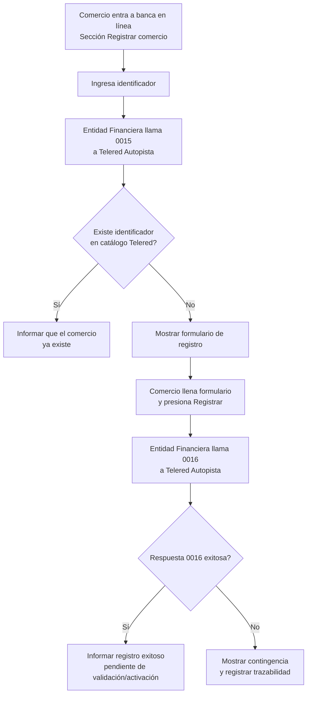
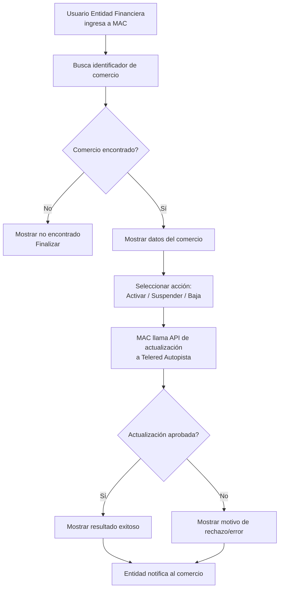

# Registro y gestión de comercios (Entidad Financiera + Telered)

## 1) Alcance

Este documento organiza el proceso en dos frentes:

1. **Registro de comercio desde banca en línea** (comercio como usuario final).
2. **Gestión de estado del comercio desde MAC** (usuario interno de la entidad financiera).

El objetivo es alinear la narrativa funcional antes de diagramar soluciones técnicas o de integración más detalladas.

---

## 2) Actores

- **Comercio**: persona/empresa que desea registrar su identificador de comercio.
- **Entidad Financiera**: sistema y personal que gestionan registro y estado del comercio.
- **Telered Autopista**: capa de integración/API que recibe métodos `0015`, `0016` y actualización de estado.
- **Telered MAC**: aplicación usada por personal de la entidad para consultar y cambiar estado.

---

## 3) Caso de Uso CU-01: Registro de comercio en banca en línea

### Objetivo
Permitir que un comercio se registre en la plataforma, validando primero si su identificador ya existe en el catálogo de Telered.

### Disparador
El comercio ingresa a la sección **Registrar comercio** en banca en línea.

### Precondiciones
- El comercio puede autenticarse en banca en línea.
- La entidad financiera tiene conectividad con Telered Autopista.
- Los métodos `0015` (consulta) y `0016` (registro) están disponibles.

### Flujo principal
1. **Comercio** entra a banca en línea y selecciona **Registrar comercio**.
2. **Comercio** ingresa el identificador que desea registrar.
3. **Entidad Financiera** arma payload de consulta y llama método `0015` en Telered Autopista.
4. **Telered Autopista** valida existencia en el catálogo de comercio.
5. **Telered Autopista** responde a la entidad financiera si el identificador existe o no.
6. Si **no existe**, **Entidad Financiera** presenta el formulario de registro.
7. **Comercio** completa formulario y presiona **Registrar**.
8. **Entidad Financiera** arma payload de alta y llama método `0016` en Telered Autopista.
9. **Telered Autopista** procesa y responde el resultado de registro.
10. **Entidad Financiera** informa al comercio que fue registrado y que queda pendiente de validación/activación.

### Flujos alternos
- **A1: Identificador ya existe**
  - En el paso 5, Telered responde que el identificador ya está registrado.
  - La entidad informa al comercio que no procede un nuevo registro.
- **A2: Error de integración (0015/0016)**
  - Si hay timeout o error técnico, la entidad muestra mensaje de contingencia y registra trazabilidad para reintento.

### Postcondiciones
- Registro creado en estado pendiente de validación, o
- Solicitud rechazada por duplicidad, o
- Proceso en contingencia por falla técnica.

---

## 4) Caso de Uso CU-02: Gestión de estado del comercio desde MAC

### Objetivo
Permitir que personal de la entidad financiera consulte un comercio y cambie su estado (activar, suspender o dar de baja).

### Disparador
Usuario interno entra a Telered MAC para administrar un identificador de comercio.

### Precondiciones
- El usuario de la entidad financiera tiene permisos en MAC.
- El identificador de comercio existe o es consultable en el sistema.
- Telered MAC tiene conectividad con Telered Autopista para actualización de estado.

### Flujo principal
1. **Entidad Financiera** ingresa a **MAC**.
2. **Entidad Financiera** busca el identificador de comercio.
3. **Telered MAC** presenta la información del comercio.
4. **Entidad Financiera** selecciona acción de estado: activar, suspender o dar de baja.
5. **Telered MAC** arma payload y llama API de actualización de estado en **Telered Autopista**.
6. **Telered Autopista** procesa la actualización y devuelve resultado.
7. **Telered MAC** muestra resultado al usuario de la entidad.
8. **Entidad Financiera** finaliza y notifica al comercio por el canal definido (correo, app u otro).

### Flujos alternos
- **B1: Comercio no encontrado**
  - En el paso 3 no se encuentran datos para el identificador.
  - Se informa al usuario y no se permite cambio de estado.
- **B2: Actualización rechazada**
  - En el paso 6, Telered Autopista rechaza el cambio por reglas de negocio o error técnico.
  - MAC muestra el motivo y la entidad define acción de seguimiento.

### Postcondiciones
- Estado del comercio actualizado y comunicado, o
- Cambio no aplicado por validación funcional/técnica.

---

## 5) Diagrama de flujo (CU-01: Registro de comercio)

---

## 6) Diagrama de flujo (CU-02: Gestión de estado en MAC)

---

## 7) Notas de modelado para discusión con el equipo

- Conviene separar explícitamente los sistemas:
  - **Canal digital de la entidad** (banca en línea),
  - **Back-end de la entidad financiera**,
  - **Telered MAC**,
  - **Telered Autopista**.
- El método `0015` se usa como **validación previa de existencia**.
- El método `0016` se usa para **registro** cuando no existe.
- El cambio de estado en MAC debe incluir catálogo controlado de estados y trazabilidad de usuario/fecha.
