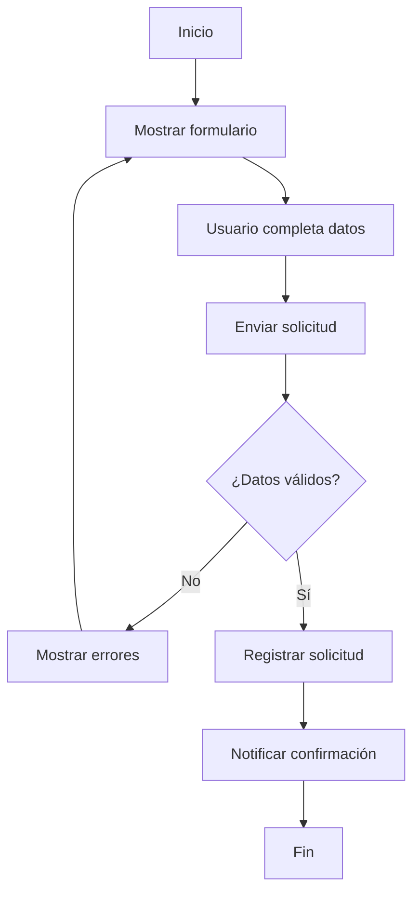

# Casos de uso y diagramas

## Objetivo

Documentar de forma simple el flujo principal de uso del sistema para facilitar discusión funcional y técnica.

## Caso de uso principal: Gestión de solicitud

**Actor principal:** Usuario  
**Resultado esperado:** La solicitud queda registrada y se notifica el estado.

### Flujo principal
1. El usuario inicia el proceso.
2. El sistema muestra el formulario.
3. El usuario completa y envía la información.
4. El sistema valida los datos.
5. Si la validación es correcta, se registra la solicitud.
6. El sistema confirma al usuario y finaliza.

### Flujo alterno
- Si faltan datos o hay formato inválido, el sistema muestra errores y vuelve al formulario.

## Diagrama de flujo

