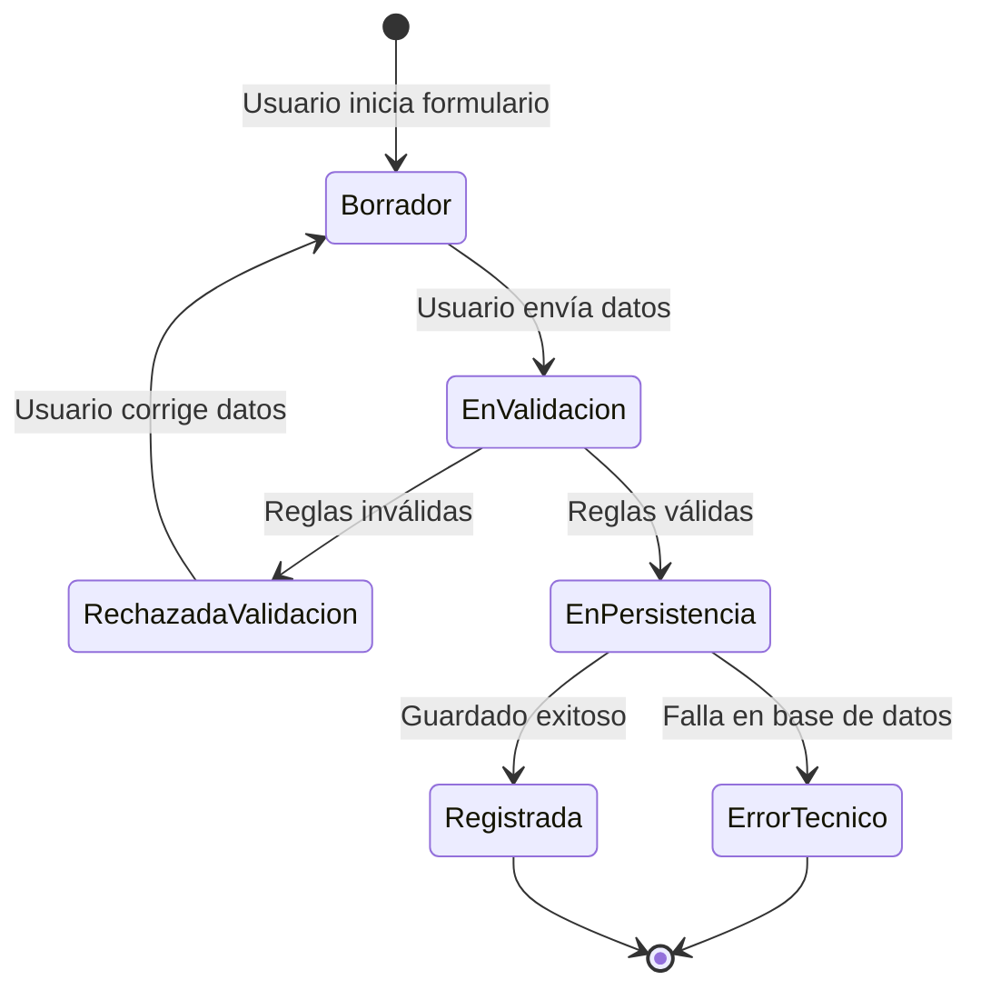

# Diagrama de estados: ciclo de vida de una solicitud

## Propósito

Modelar cómo evoluciona la solicitud desde su creación hasta su estado final inmediato dentro del proceso de registro.

## Justificación del diagrama adicional

Este diagrama complementa flujo y secuencia porque:

1. Define estados explícitos para trazabilidad y monitoreo.
2. Facilita diseño de reglas de transición en backend.
3. Ayuda a QA a validar transiciones válidas e inválidas.
