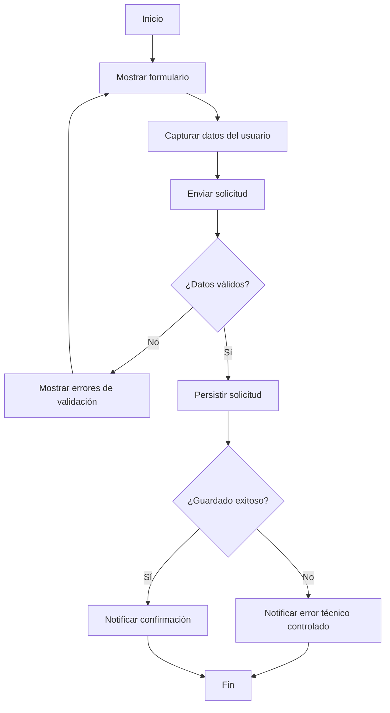

# Diagrama de flujo: registrar solicitud

## Propósito

Visualizar el recorrido operativo y los puntos de decisión del proceso de registro.

## Observaciones

- El bucle de validación evita persistir información inválida.
- Se separa explícitamente la falla funcional (validación) de la falla técnica (persistencia).
