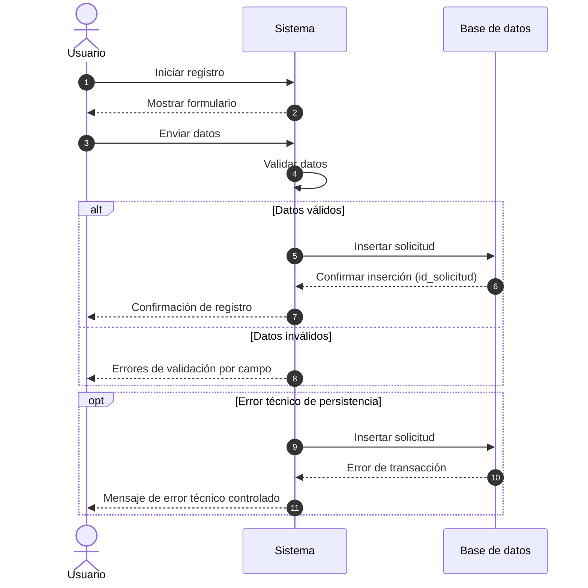

# Diagrama de secuencia: registrar solicitud

## Propósito

Describir el intercambio de mensajes entre actores y componentes durante la operación.

## Observaciones

- Se modela tanto el camino funcional (validación) como el camino técnico (transacción fallida).
- El sistema mantiene mensajes controlados hacia el usuario final.
